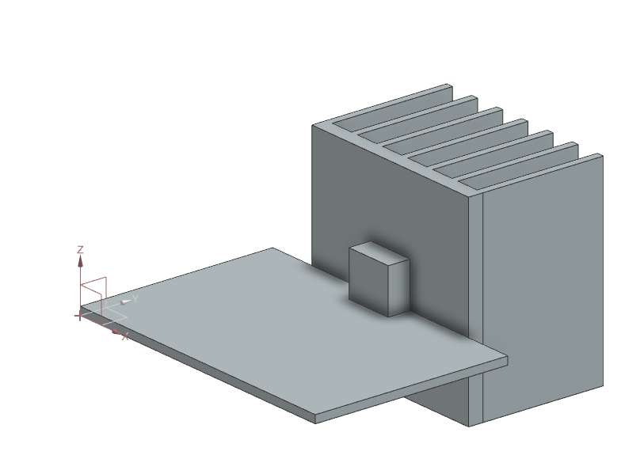
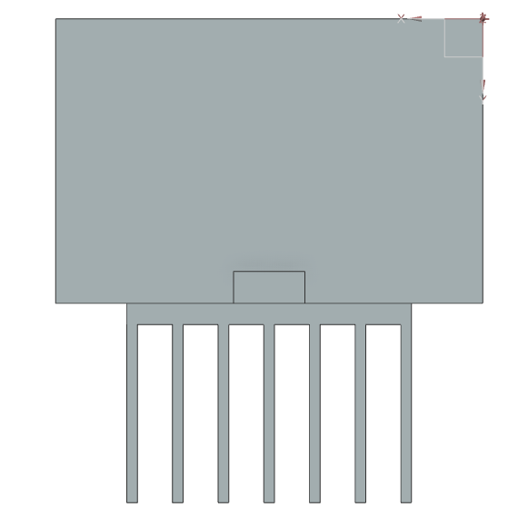
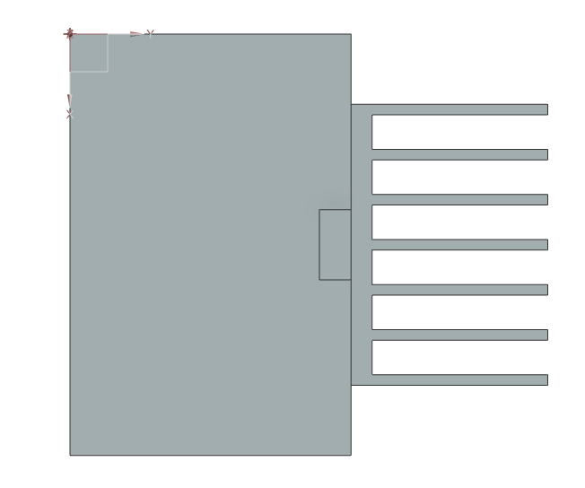

# Thermal-Aware CAD Model of an LM7805 (NX CAD + 3D Thermal Analysis)

An LM7805 regulator dissipating 3.5 W (12 V in, 5 V out, 0.5 A) on a PCB, cooled by a 7-fin aluminium heat sink.
The CAD model is built in Siemens NX; the junction temperature is predicted by a hand calculation and by a custom 3D
finite-volume thermal solver (NumPy/SciPy) that runs on STL files exported from NX.

**Result:** 79.0 °C simulated vs 80.2 °C by hand (3% difference in temperature rise), against a 100 °C design limit.
Without a heat sink: about 260-270 °C.

## NX model

Built in Siemens NX: PCB, LM7805 regulator and a 7-fin aluminium heat sink.



| Top view | Top view, rotated 90° |
| --- | --- |
|  |  |

## Files
| File | Purpose |
| --- | --- |
| `regulator_heatsink.py` | Solver, hand calculation and a built-in parametric model (writes `assembly.stl`, plots) |
| `solve_from_stl.py` | Runs the solver on your NX-exported STL files |
| `sweeps.py` | Convection-coefficient sensitivity and fin-count sweep |
| `pcb.stl`, `7805_regulator.stl`, `heatsink.stl` | Bodies exported from the NX model (mm) |
| `figures/` | Labelled NX model, temperature map, sweep plots |

## Run
```
python -m pip install numpy scipy matplotlib
python regulator_heatsink.py
python solve_from_stl.py pcb.stl 7805_regulator.stl heatsink.stl
python sweeps.py pcb.stl 7805_regulator.stl heatsink.stl
```
STL order is always: PCB, regulator, heat sink.

## Method (short)
The model is voxelised into 0.5 mm cubes. Each cube is a node; neighbouring cubes are linked by a thermal conductance
(k·A/d), surface cubes lose heat by convection (h·A), and the 3.5 W enters at a small die region. Heat balance at
every node gives `G·T = Q`, solved with SciPy.

## Limitations
- Convection is one assumed value (h = 10 W/m²K); results scale with it (h = 5 gives 95 °C).
- Package conductivity is tuned so the simulated junction-to-case resistance matches the datasheet (5 °C/W).
- Not compared with a measurement or a commercial solver.
